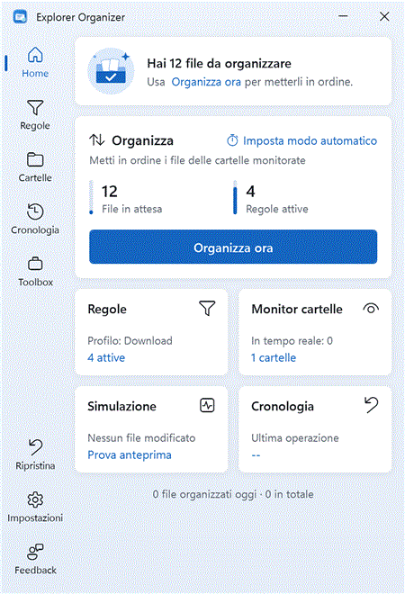

<p align="center">
  
</p>

<h1 align="center">Explorer Organizer</h1>

<p align="center"><b>Tidy folders on autopilot: IF … THEN rules for your files, with preview and one-click undo.</b></p>

<p align="center">
  <a href="https://github.com/giovanniluci/explorer-organizer/releases/latest"></a>
  <a href="https://github.com/giovanniluci/explorer-organizer/releases"></a>
  <a href="LICENSE"></a>
  
  
</p>

<p align="center">
  <a href="https://github.com/giovanniluci/explorer-organizer/releases/latest"></a>
</p>

<p align="center">English · <a href="README.it.md">Italiano</a></p>

<p align="center">
  
</p>

Explorer Organizer is a free, open-source file organizer for Windows. You describe what should happen to your files
(“PDF invoices → `Documents\Invoices\{modified:yyyy}`”), and it does it when you drop files on it, right-click them in
Explorer, or automatically while it watches your folders. Everything stays on your PC: no account, no cloud, no telemetry.

## Features

- 🧩 **Visual IF … THEN rules**: nested ALL/ANY groups and NOT on any condition. The first matching rule wins.
- 🔎 **Rich conditions**: name and path (wildcards, regex), extension, file type, size, dates (including EXIF date taken),
  attributes, metadata (EXIF, ID3, document properties, any Windows `System.*` property) and text content (Office, ODT, RTF, text PDFs).
- 🛠️ **Actions**: move, copy, rename, sort into subfolders, delete to the Recycle Bin, zip, unzip, create shortcut, open with.
- 🏷️ **Tokens for names and paths**, such as `{taken:yyyy/MM}`, `{id3:Artist}`, `{match:1}` and `{hash:sha256}`, with filters like `|upper` and `|default:…`.
- ⚡ **Many ways to run**: drag & drop on the window or a floating drop target, Explorer context menu, Send To,
  real-time monitoring, interval or daily schedules, command line.
- 👀 **Preview first**: see every source → destination before anything moves, or use simulation mode for automatic rules.
- ↩️ **Undo**: the last 50 runs can be undone, even after a restart. Deletions and replacements always go through the Recycle Bin.
- 🎨 **Native Windows 11 look**: Mica, light/dark/high-contrast themes, keyboard navigation. UI in English and Italian.

## How it compares

A quick comparison with two well-known tools, based on their public documentation (October 2026).
Full details and sources are in [docs/feature-matrix.md](docs/feature-matrix.md).

| | DropIt | File Juggler | Explorer Organizer |
|---|:-:|:-:|:-:|
| Drag & drop on a floating target | ✔ | ✖ | ✔ |
| Real-time folder monitoring | ~ (interval scan) | ✔ | ✔ |
| Nested AND/OR condition groups | ✖ | ✔ | ✔ |
| Explorer context menu | ✖ | ✖ | ✔ |
| Preview before applying | ✖ | ~ | ✔ |
| Undo last operations | ✖ | ✖ | ✔ |
| Rule profiles with import/export | ✔ | ✖ | ✔ (JSON) |
| Portable edition | ✔ | ✖ | ✔ |
| Extract archives | ✔ (many formats) | ✔ (zip, rar) | ZIP only |
| Languages | 20+ | English | English, Italian |

## Installation

Download from the [latest release](https://github.com/giovanniluci/explorer-organizer/releases/latest):

| File | Use |
|---|---|
| `ExplorerOrganizer-Setup.exe` | Installer. Installs for the current user only by default (no admin rights). Optional: desktop icon, Explorer context menu, Send To, start with Windows. |
| `ExplorerOrganizer-Portable.zip` | Portable edition. Extract and run `ExplorerOrganizer.exe`; settings are stored in a `data\` folder next to it. |
| `SHA256SUMS.txt` | Checksums. Verify with `Get-FileHash <file> -Algorithm SHA256`. |

Requirements: Windows 10 1809+ or Windows 11, x64. The app is self-contained, so you don't need to install .NET.

To uninstall, go to *Settings → Apps*. Your organized files are never touched. You are asked whether to keep your settings.

## Quick start: your first rule

1. Start the app. The first-run wizard offers ready-made presets (Downloads, Photos, Documents, Music).
2. Open **Rules → New rule** and build:
   - **IF** *File type* is *Images*
   - **THEN** *Move* to `{pictures}\{taken:yyyy/MM}`
3. Drop a few photos on the window. The preview shows where each one will go (for example `Pictures\2026\10`). Confirm.
4. Changed your mind? **Restore → Undo last operation**.

To run it automatically, add your Downloads folder in **Folders** and set *When* to *Real time*.

More tokens, conditions and the command line are documented in the [Italian guide](README.it.md#guida-rapida).

## FAQ

<details>
<summary><b>Windows SmartScreen says “Windows protected your PC”. Is it safe?</b></summary>

The executables are not code-signed yet (certificates are expensive for a free project), so SmartScreen warns about
any new, unsigned download. Click **More info → Run anyway**. You can check that the file is the one built by GitHub Actions by
comparing its hash with `SHA256SUMS.txt` in the release, or build it yourself from source (see below).
</details>

<details>
<summary><b>Does it send any data?</b></summary>

No. The app makes no network connections. Feedback is saved to a file or copied to the clipboard, never sent.
</details>

<details>
<summary><b>Can a rule destroy my files?</b></summary>

Deletions and “replace” conflicts go to the Recycle Bin. Where there is no Recycle Bin (network or removable drives), these
actions are refused. Permanent deletion needs explicit confirmation and is never used by automatic runs. Every run can be undone.
</details>

<details>
<summary><b>Where are settings stored?</b></summary>

`%AppData%\ExplorerOrganizer` for the installed version and `data\` next to the exe for the portable one.
</details>

## Build from source

```powershell
git clone https://github.com/giovanniluci/explorer-organizer.git
cd explorer-organizer
powershell -ExecutionPolicy Bypass -File .\build.ps1 -BootstrapTools
```

`-BootstrapTools` downloads the .NET 8 SDK and Inno Setup 6 into `.tools\` inside the repo, without changing your system.
Output: `artifacts\ExplorerOrganizer-Portable.zip` and `installer\Output\ExplorerOrganizer-Setup.exe`.
Options: `-SkipUiTests`, `-SkipInstaller`, `-Verify`. Test map: [docs/test-matrix.md](docs/test-matrix.md).

## Roadmap

These are ideas, not promises. Vote with 👍 on the issues.

- [ ] Code-signed releases
- [ ] `winget` package
- [ ] 7z / RAR extraction
- [ ] More UI languages (translations welcome)
- [ ] Word lists for content conditions

## Contributing

Bug reports, rule ideas and pull requests are welcome. Start with [CONTRIBUTING.md](CONTRIBUTING.md).
Report security issues privately as described in [SECURITY.md](SECURITY.md).

## License

[MIT](LICENSE) © Explorer Organizer contributors
